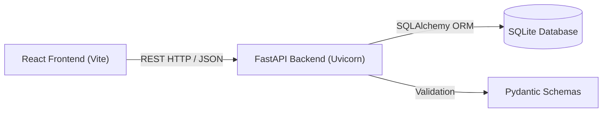

<div align="center">

# 🎓 StudentHub — Student Management System

[](https://fastapi.tiangolo.com/)
[](https://reactjs.org/)
[](https://www.typescriptlang.org/)
[](https://vitejs.dev/)
[](https://tailwindcss.com/)
[](https://www.python.org/)
[](https://www.sqlite.org/)
[](LICENSE)

<p align="center">
  A modern, high-performance <b>Student Management System</b> built with a responsive <b>React & TypeScript</b> frontend and a robust <b>FastAPI (Python)</b> REST backend with <b>SQLite</b> persistence.
</p>

[Key Features](#-key-features) •
[Quick Start](#-quick-start-windows) •
[Architecture](#-architecture--repository-structure) •
[API Reference](#-rest-api-reference) •
[Documentation](#-documentation--links)

</div>

---

## 📌 Overview

**StudentHub** simplifies academic record administration. It replaces error-prone spreadsheets with an interactive, modern workspace offering real-time directory search, multi-column sorting, modal forms, student detail views, and a dedicated REST API with Pydantic validation.

### Core Objectives
- ⚡ **Streamlined Workflow**: Intuitive single-page dashboard designed for registrars and educators.
- 🛡️ **Data Integrity**: Enforced schemas and validation rules via Pydantic v2 and SQLAlchemy ORM.
- 🗃️ **Zero-Friction Persistence**: Embedded SQLite storage requiring zero external database configuration for local deployment.
- 🔍 **Fast Retrieval**: Instant multi-field search and pagination across active student records.

---

## ✨ Key Features

| Feature | Description |
|---|---|
| 📊 **Dashboard Overview** | Live KPI summary cards (Total Students, Recently Added, Recently Updated) and quick actions. |
| 🔍 **Live Directory Search** | Instant case-insensitive filtering by student full name, student ID, and email. |
| 🔄 **Multi-Column Sorting** | Toggleable ascending/descending sorting on Name, Student ID, Email, and Date of Birth. |
| 📝 **Add & Edit Modal Forms** | Real-time input validation (RFC email format, required dates, and phone/email requirements). |
| 👤 **Student Profile View** | Detailed profile card displaying contact details, date of birth, and home address. |
| 🗑️ **Defensive Deletion** | Safe confirmation dialogs to prevent accidental removal of records. |
| 🤖 **AI Assistant Interface** | Integrated preview panel prepared for student query analytics and insights. |
| 📖 **Interactive API Docs** | Auto-generated Swagger UI (`/docs`) and ReDoc (`/redoc`) powered by OpenAPI. |

---

## 🏗️ Architecture & Repository Structure

### System Architecture


### 📂 Repository Tree Structure

```text
Student-Management-System/
│
├── 📁 backend/                           # FastAPI Backend Application
│   ├── 📁 app/                           # Application Core Logic
│   │   ├── 📁 routers/                   # API Route Handlers
│   │   │   ├── __init__.py               # Python package marker
│   │   │   └── students.py               # Student CRUD REST endpoints
│   │   ├── __init__.py                   # Package initialization
│   │   ├── database.py                   # SQLAlchemy engine, session maker & connection
│   │   ├── main.py                       # FastAPI application entry, CORS & routes
│   │   ├── models.py                     # SQLAlchemy ORM student model (DB table)
│   │   └── schemas.py                    # Pydantic validation schemas & request models
│   ├── 📁 tests/                         # Automated Testing Suite
│   │   └── test_students.py              # Pytest unit & integration test cases
│   ├── .env.example                      # Template for backend environment variables
│   ├── .gitignore                        # Python & backend-specific ignore rules
│   └── requirements.txt                  # Python dependencies (FastAPI, SQLAlchemy, Uvicorn)
│
├── 📁 project/                           # React + TypeScript Frontend (Vite)
│   ├── 📁 src/                           # Client Application Source
│   │   ├── App.tsx                       # Main Dashboard, Student Table, Modals & Navigation
│   │   ├── index.css                     # Global styles, Tailwind CSS & theme tokens
│   │   ├── main.tsx                      # React 18 DOM mount point
│   │   └── vite-env.d.ts                 # TypeScript type declarations for Vite
│   ├── .env.example                      # Template for frontend environment variables
│   ├── .gitignore                        # Frontend-specific ignore rules
│   ├── eslint.config.js                  # ESLint 9 linting rules & config
│   ├── index.html                        # HTML single-page entry document
│   ├── package.json                      # NPM dependencies & project scripts
│   ├── package-lock.json                 # Deterministic dependency lockfile
│   ├── postcss.config.js                 # PostCSS configuration for Tailwind
│   ├── tailwind.config.js                # Tailwind CSS design system configuration
│   ├── tsconfig.app.json                 # TypeScript compiler configuration for source
│   ├── tsconfig.json                     # TypeScript root references
│   ├── tsconfig.node.json                # TypeScript configuration for build tooling
│   └── vite.config.ts                    # Vite server, path aliases & build settings
│
├── 📁 docs/                              # Project Documentation
│   └── API.md                            # Comprehensive REST API endpoint specifications
│
├── .gitignore                            # Root repository Git ignore rules
├── CONTRIBUTING.md                       # Contribution guidelines & workflow rules
├── LICENSE                               # Project software license
└── README.md                             # Main project README documentation
```

---

## 🚀 Quick Start (Windows)

### Prerequisites
Make sure you have installed:
- [Python 3.10+](https://www.python.org/downloads/) *(Ensure "Add Python to PATH" is checked)*
- [Node.js 18+ & npm](https://nodejs.org/)
- [Git](https://git-scm.com/)

---

### Step 1: Clone the Repository
```powershell
git clone https://github.com/tanushkaagupta/Student-Management-System.git
cd "Student-Management-System"
```

---

### Step 2: Run the Backend (FastAPI)

Open a PowerShell terminal:

```powershell
# Navigate into backend directory
cd backend

# Create virtual environment
python -m venv venv

# Activate virtual environment
.\venv\Scripts\Activate.ps1

# Install required dependencies
pip install -r requirements.txt

# Start the development server
uvicorn app.main:app --reload --host 127.0.0.1 --port 8000
```

> **Backend is running at:**
> - **API Base URL**: `http://127.0.0.1:8000`
> - **Interactive Swagger Docs**: `http://127.0.0.1:8000/docs`
> - **ReDoc Alternative**: `http://127.0.0.1:8000/redoc`

---

### Step 3: Run the Frontend (React + Vite)

Open a **second** PowerShell terminal:

```powershell
# Navigate into frontend directory
cd project

# Install NPM dependencies
npm install

# Launch Vite development server
npm run dev
```

> **Frontend is running at:**
> - **Web Application**: `http://localhost:5173`

---

## ⚙️ Environment Variables

Copy the provided example files to configure environment variables:

### Backend Configuration (`backend/.env`)
```powershell
Copy-Item backend/.env.example backend/.env
```
| Key | Default | Description |
|---|---|---|
| `STUDENT_DB` | `sqlite:///student.db` | SQLAlchemy connection URL |
| `HOST` | `127.0.0.1` | Host IP for uvicorn server |
| `PORT` | `8000` | Port for uvicorn server |

### Frontend Configuration (`project/.env`)
```powershell
Copy-Item project/.env.example project/.env
```
| Key | Default | Description |
|---|---|---|
| `VITE_API_BASE_URL` | `http://127.0.0.1:8000` | Backend API URL for client requests |

---

## 📡 REST API Reference

For detailed request and response payloads, see the complete [API Documentation](docs/API.md).

| HTTP Method | Endpoint | Description | Status Code |
|---|---|---|---|
| `GET` | `/` | API Root Health & Welcome Message | `200 OK` |
| `GET` | `/health` | Liveness health check | `200 OK` |
| `GET` | `/students/` | List students (`skip`, `limit`, `search`) | `200 OK` |
| `POST` | `/students/` | Create a new student record | `201 Created` |
| `GET` | `/students/{student_id}` | Retrieve single student by ID | `200 OK` |
| `PUT` | `/students/{student_id}` | Update student details (partial updates) | `200 OK` |
| `DELETE` | `/students/{student_id}` | Delete a student record | `204 No Content` |

### Sample Request: Register Student (`POST /students/`)
```json
{
  "student_id": "STU025",
  "full_name": "Riya Sen",
  "date_of_birth": "2004-05-14",
  "email": "riya.sen@example.com",
  "phone": "+91 98765 12345",
  "address": "45 Park Lane, Kolkata"
}
```

### Sample Response (`201 Created`)
```json
{
  "student_id": "STU025",
  "full_name": "Riya Sen",
  "date_of_birth": "2004-05-14",
  "email": "riya.sen@example.com",
  "phone": "+91 98765 12345",
  "address": "45 Park Lane, Kolkata",
  "id": 1,
  "created_at": "2026-10-15T18:00:00Z",
  "updated_at": null
}
```

---

## 🧪 Testing & Code Quality

### Frontend Checks
Run in the `project/` directory:
```powershell
npm run lint         # Runs ESLint 9 checks
npm run typecheck    # Runs TypeScript type validation
npm run build        # Generates production bundle in dist/
```

### Backend Automated Tests
Run in the root or `backend/` directory with active venv:
```powershell
pytest backend/tests/test_students.py -v
```

---

## 🔒 Security Best Practices

- **Zero Secrets Committed**: All `.env` files and SQLite database files are strictly ignored in `.gitignore`.
- **CORS Protection**: Access is restricted in `backend/app/main.py` to local Vite origins by default.
- **Strict Data Validation**: Pydantic models automatically sanitize and validate types, lengths, and email formats.

---

## 🤝 Contributing

Contributions are welcome! Please check out [CONTRIBUTING.md](CONTRIBUTING.md) for pull request workflows, branch naming guidelines, and instructions.

---

## 📄 License

This project is open-source and distributed under the **[MIT License](LICENSE)**.
